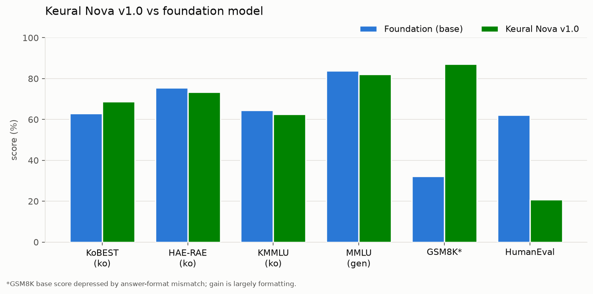

# Keural Nova v1.0: A Korean-Specialized Mixture-of-Experts Language Model

**MKD AI Research** · Model release

> **TL;DR** — Keural Nova v1.0 is MKD's Korean-specialized large language model: a
> 35B-parameter Mixture-of-Experts model (~3B active parameters per token) adapted through
> large-scale, MoE-aware supervised fine-tuning on a 253K-example, Korean-majority instruction
> corpus. It delivers a **+5.9-point gain on KoBEST** over its foundation model while
> preserving general-domain capability, and it is fully self-hostable under a permissive
> commercial license.

---

## Why we built it

General-purpose foundation models are increasingly strong at Korean, but "strong at Korean" and
"native-quality Korean assistant" are not the same thing. Off-the-shelf models tend to
code-switch (dropping English words into Korean sentences), default to translated-sounding
phrasing, and miss register — the difference between casual speech and the honorifics expected
in a business email.

Keural Nova is our effort to close that gap: a model that is **efficient to serve, deployable
on our clients' own infrastructure, and genuinely fluent in Korean** — not a wrapper around a
third-party API.

## The foundation

Keural Nova v1.0 is built on **Qwen3.6-35B-A3B** (Apache 2.0), a modern Mixture-of-Experts
foundation model. We selected it for three engineering reasons:

- **Efficiency.** The MoE design activates only ~3B of its 35B parameters per token — large-model
  quality at a fraction of the inference cost.
- **Permissive licensing.** Apache 2.0 gives clean, unrestricted commercial rights and
  self-hosting with no per-token vendor dependency.
- **Strong multilingual base + long context.** A capable starting point with a 256K-token
  context window we retain end to end.

All Korean specialization, data curation, training methodology, evaluation, and deployment
engineering below is MKD's own work.

## The interesting engineering problem: adapting an MoE correctly

Fine-tuning a Mixture-of-Experts model is not the same as fine-tuning a dense model, and getting
it wrong fails *silently*. The routed experts — where most of the model's capacity lives — are
not standard linear layers; they are fused parameter tensors. A naive fine-tune adapts the
attention layers and the small shared components, leaves the routed experts untouched, and
still shows a decreasing loss curve. You only discover the mistake when the model underperforms
for reasons the training logs never revealed.

We built the training pipeline around this hazard:

- **MoE-aware LoRA targeting.** We adapt attention, the linear-attention (Gated-DeltaNet)
  projections, the shared experts, **and all 256 routed experts per layer** across all 40 layers
  — the routed experts reached through parameter-level adaptation, not module-name matching.
- **Deliberate freezing.** The MoE **router** and gating modules are frozen and verified
  bit-identical to the foundation model after training — we change *what the experts know*, not
  *how tokens are routed*.
- **An automated verification gate.** Before every run and again on every saved checkpoint, an
  automated check fails loudly unless the router is frozen and the routed experts are correctly
  adapted on every layer. Silent mis-targeting cannot reach a release.

## Training data

253,528 examples, ~85% Korean / ~15% English, drawn from 13 curated sources spanning
conversation, retrieval-grounded Q&A, instruction-following, math, and code. Two principles
governed the corpus:

1. **Commercial cleanliness.** Only permissively-licensed data (MIT / Apache-2.0 / CC BY /
   CC BY-SA). Non-commercial and restricted-license sources were deliberately excluded.
2. **Replay for capability retention.** The ~15% English/general "replay" slice is deliberate —
   it is the insurance against catastrophic forgetting, keeping general-domain ability intact
   while the Korean-majority data drives specialization.

| Property | Value |
|---|---|
| Total examples | 253,528 |
| Language mix | ~85% Korean / ~15% English |
| Sources | 13 (conversation, RAG, instruction, math, code) |
| Format | ChatML, non-thinking response path |
| Max sequence length | 8,192 tokens |
| License policy | Commercial-clean only; AI-Hub / non-commercial excluded |

## Results

We evaluated with the industry-standard `lm-evaluation-harness` (vLLM backend, bf16, fixed seed),
running the **identical** harness and settings on both the foundation model and Keural Nova so
the comparison is apples-to-apples.



| Benchmark | Suite | Foundation | **Keural Nova v1.0** | Δ |
|---|---|---:|---:|---:|
| KoBEST | Korean | 62.88 | **68.82** | **+5.94** |
| HAE-RAE | Korean | 75.53 | 73.42 | −2.11 |
| KMMLU | Korean | 64.46 | 62.52 | −1.94 |
| MMLU | General | 83.83 | 82.07 | −1.76 |
| GSM8K (strict) | Math | 32.15\* | 87.11 | +54.96\* |
| HumanEval | Code | 62.20 | 20.73 | −41.47 |

\* The foundation model's GSM8K score is depressed by answer-format mismatch under strict
extraction; the jump is largely improved answer *formatting*, not a reasoning leap.

**What the numbers say — honestly:**

- **Korean conversational understanding improves clearly** (KoBEST +5.9). This is the target
  capability, and it moved.
- **General knowledge is preserved** at foundation-model level (MMLU/KMMLU/HAE-RAE within ~2
  points — the model did not "forget" its general ability).
- **Answer formatting and instruction-following improve markedly** (reflected in the GSM8K
  formatting gain).
- **Code generation regressed** and is a known limitation of v1.0 (see below). Keural Nova is
  positioned as a Korean-language model, not a coding model.

Beyond benchmarks, the qualitative difference is visible in everyday use: Keural Nova produces
clean, natural Korean without the English code-switching common to general foundation models.

## Known limitations

We believe honest limitations are part of a serious model release:

- **Not a code-generation model.** HumanEval regressed (62 → 21 pass@1). We traced the root
  cause to indentation corruption in one upstream code data source that the model learned; it is
  a data-quality issue with a clear fix, scheduled for the next release.
- **Knowledge benchmarks dip slightly** (~1–2 points). Supervised fine-tuning sharpens behavior;
  it does not add knowledge, and a small trade-off against the foundation is expected.
- **Long-context behavior is untested.** The architectural 256K context window is retained, but
  training used 8,192-token sequences, so we make no claim about very-long-context quality yet.

## Availability & licensing

Keural Nova v1.0 is a fully merged model — no adapter loading required — and serves directly
with vLLM or Transformers.

```bash
vllm serve mkd-hossain/Keural-Nova-v1.0 --tensor-parallel-size 2 --dtype bfloat16
```

It runs on standard datacenter GPUs and is deployable **on-premise, in a private cloud, or as a
hosted API** — with all data remaining in the client's environment when self-hosted. The
foundation model's Apache 2.0 license and our commercial-clean data policy give a clean footing
for commercial and business use.

## What's next

The next release focuses on repairing the code-data issue, rebalancing response length, and
adding benchmark-format-aligned data to lift Korean knowledge scores — all while holding general
capability flat and verifying it, not assuming it.

---

*Built on Qwen3.6-35B-A3B (Qwen team, Alibaba Cloud; Apache 2.0). Korean data curation, MoE-aware
training methodology, evaluation, and deployment by MKD AI Research.*
