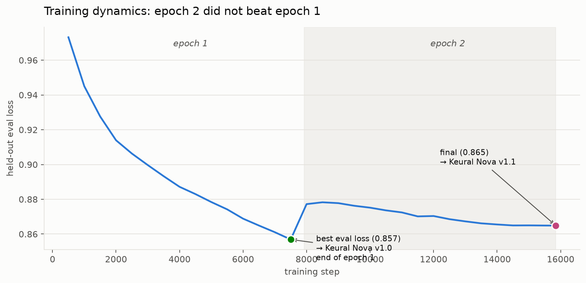

# Keural Nova v1.1, and What Two Epochs Taught Us About Fine-Tuning MoE Models

**MKD AI Research** · Engineering notes

> **TL;DR** — Keural Nova v1.1 is the full two-epoch training endpoint of the same run that
> produced v1.0. Publishing both let us answer a practical question with data: *does a second
> epoch help?* The honest answer — measured on a held-out set — is **no, not here**, and the
> reasoning behind why we still shipped both is a useful lesson in disciplined model selection.

---

## Two siblings from one run

Keural Nova v1.0 and v1.1 come from the **same training run** on the same 253K-example
Korean-majority corpus:

- **v1.0** is the checkpoint at the end of **epoch 1** (step 7,500), selected as the
  best held-out eval-loss point.
- **v1.1** is the **final** checkpoint after the full **two epochs** (step 15,846).

Rather than quietly keep one and discard the other, we released both and documented the
difference. This is the more useful engineering story: not "here is a model," but "here is what
the training told us."

## The training curve tells the story

We evaluated held-out loss every 500 steps throughout training. The curve is unambiguous:



Eval loss falls steadily through epoch 1 and bottoms out at **0.857 at step 7,500** — exactly
the end of the first epoch. Then the second epoch begins, loss **jumps up**, and spends all of
epoch 2 slowly recovering to **0.865** — never re-beating the epoch-1 best.

This is a textbook signature: on a strong foundation model, a single well-constructed epoch of
supervised fine-tuning captures essentially all the available gain. A second epoch mostly
re-fits data the model has already absorbed, adding overfitting pressure and forgetting risk
without a corresponding held-out improvement.

## So why ship v1.1 at all?

Two reasons, both practical:

1. **Transparency.** Eval loss is a proxy, not ground truth. By publishing the full-training
   checkpoint alongside the eval-selected one, anyone can verify our selection decision on their
   own workload instead of taking our word for it.
2. **Marginal task-level trade-offs.** Held-out loss is a single aggregate; individual benchmarks
   diverge slightly. On the downstream evals, v1.1 edges v1.0 on a couple of tasks while v1.0
   leads on others:

| Benchmark | Suite | Foundation | Keural Nova v1.0 | Keural Nova v1.1 |
|---|---|---:|---:|---:|
| KoBEST | Korean | 62.88 | **68.82** | 67.29 |
| HAE-RAE | Korean | 75.53 | 73.42 | **74.52** |
| KMMLU | Korean | 64.46 | **62.52** | 62.38 |
| MMLU | General | 83.83 | 82.07 | **82.37** |
| GSM8K (strict) | Math | 32.15\* | 87.11 | 86.88 |
| HumanEval | Code | 62.20 | **20.73** | 11.59 |

\* Foundation GSM8K depressed by answer-format mismatch; the gain is largely formatting.

The pattern: **v1.0 is the stronger default** (better KoBEST and better-retained code), while
**v1.1 is marginally better on HAE-RAE and MMLU**. Neither is universally ahead — which is
exactly why we let users choose empirically rather than declaring one "the" model.

## The methodology, briefly

Both models share the same disciplined MoE fine-tuning setup (covered in depth in the
[Keural Nova v1.0 release](article1_keural_nova_v1.0.md)):

- MoE-aware LoRA adapting attention, linear-attention, shared experts, **and all 256 routed
  experts per layer** — with the router frozen and verified bit-identical to the foundation
  model, before and after training.
- Foundation: Qwen3.6-35B-A3B (Apache 2.0), a 35B-parameter / ~3B-active MoE model.
- Effective batch 32, LR 1e-4 cosine, bf16, DeepSpeed ZeRO-2, on 2× NVIDIA H200 (~68 hours for
  the full two-epoch run).

## What this changes for the next release

The training curve is not just an interesting artifact — it is a design decision for v2:

- **One epoch, not two.** The data says the second epoch does not earn its cost. The next run
  will be single-epoch, freeing compute budget for better data instead of redundant passes.
- **Lower learning rate.** To further reduce the forgetting pressure visible as the epoch-2
  bump.
- **Better data over more data.** Repaired code data (fixing the HumanEval regression),
  benchmark-format-aligned Korean examples to lift knowledge scores, and balanced response
  lengths — with general capability held flat and *measured* before release.

## Choosing between v1.0 and v1.1

- **Default / most use cases → v1.0.** Strongest Korean conversational performance and better
  retained general behavior.
- **If your evaluation favors it → v1.1.** Marginally better on some knowledge tasks; worth a
  side-by-side on your own data.

Both are self-hostable, commercially licensed, and serve directly:

```bash
vllm serve mkd-hossain/Keural-Nova-v1.1 --tensor-parallel-size 2 --dtype bfloat16
```

---

*Built on Qwen3.6-35B-A3B (Qwen team, Alibaba Cloud; Apache 2.0). Korean data curation, MoE-aware
training methodology, evaluation, and deployment by MKD AI Research.*
